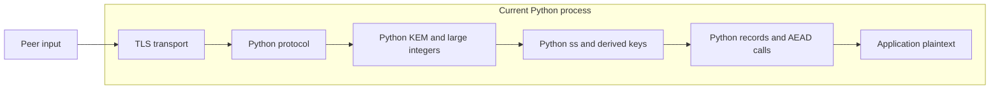
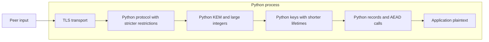
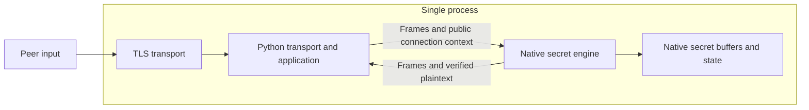
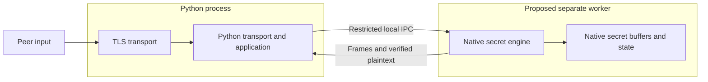

# Security Hardening Proposal: Native Ownership of Secret Operations and Lifetimes

## Decision

Status: **design proposal, before implementation**. Reference commit: `7c859d9`.
This proposal addresses item 2: constant-time implementation, randomness, and secret lifetimes.
Researcher engagement is deferred; no new claim is made about the current cryptography's mathematical security.

## Executive Recommendation

The choices are **option 1: stricter Python restrictions**, **option 2: a Rust native secret engine**,
and **option 3: a native secret engine in a separate process**.
I recommend option 2 as the first implementation preserving compatibility with the current local research protocol.
We will move not only polynomial multiplication but also KEM secrets, key derivation, Finished, AEAD, and key disposal.

Option 2 reduces key copying in the interpreter while allowing continued testing of the existing TLS transport code.
In return, it requires native module builds and validation for each compiler and library.
If protection against compromise of the Python process is required, opaque handles in the same address space are insufficient;
choose option 3 with process isolation together with an OS permissions policy.

## Evidence

I directly inspected the code paths for key generation, reencryption, key transfer, and disposal.
The observations below do not indicate a successful new key-recovery attack. We distinguish the need for design changes
inferred from observations from proposals still requiring validation.

| Evidence | Finding or document | What it establishes |
|---|---|---|
| `bigint` | OPT2 large-integer multiplication after fixed byte packing, `code/opt2/spiral_kem_toy_v031_opt2.py:479–508` | Observation: secret operands enter Python arbitrary-precision arithmetic. Fixed output length does not establish constant time |
| `secret-flow` | OPT2 reencryption, sampling, Encode/Decode, same file `216–248`, `581–618`, `372–382` | Observation: conditionals and object operations depend on recovered messages and secret coefficients |
| `python-keys` | `protocol_v01/handshake.py:42–49`, `284–302`, `records.py:35–50`, `128–130`, `193–195` | Observation: ss, PRK, and data keys are also computed and stored in Python after KEM |
| `cleanup` | `protocol_v01/records.py:83–92`, `handshake.py:415–416`, `437–438` | Observation: references are released, but overwriting previous memory copies is not guaranteed |
| `timing` | `protocol_v01/validation/results/timing.json` and `validation/README.md` | Observation: 24,000 exploratory measurements in one environment. Not proof of constant time or absence of leakage |
| `compatibility` | `protocol_v01/SPEC_v0.1.md`, `tests/fixtures/test_vectors_v0.1.json`, `validation/RESULTS.json` | Observation: fixed frames, hashes, key schedule, and existing 75 regression tests can serve as compatibility baselines |

Inference: secret ownership is distributed across multiple Python function, object, and library boundaries,
so making a single KEM function native leaves the `python-keys` and `cleanup` issues unresolved.
We therefore establish one lifetime boundary from secret generation through the last use of derived keys.

## Current Design And Failure Mode

Attackers can submit public keys, ciphertexts, and frames and observe external responses and timing.
Current TLS, parsers, and single-use decapsulation restrict attacker input paths and repeated queries.
However, `_poly_mul` converts coefficients, including secrets, into large integers and multiplies them,
and Encode/Decode and internal canonicality checks also use Python conditionals and object execution.
Changing only the comparison and masking portion cannot control execution characteristics of the complete path.

The reencrypted expected ciphertext is a sensitive derived value until it is determined to equal the received ciphertext.
In particular, for ciphertexts that will be rejected, do not log or return it externally as though it were public data.
We must distinguish early failure for public format checks on external inputs from execution rules for paths that use secrets.
Rejection sampling that constructs A from public matrix_seed depends only on public information and may use variable iteration counts.

Even after KEM completes, `SessionKeys` fields and `RecordState` retain session keys.
Assigning `None` or destroying a Python object is not evidence of erasure of previous temporary bytes, buffers, or stack copies.
This structure does not prove direct remote key recovery, but fails to meet item 2's completion criteria.

## Desired Invariants

- Secret values are not used to select branch conditions, iteration counts, memory addresses, or variable-length allocations. Public lengths, types, states, and cancellation signals are classified separately.
- Allowed disclosure points are final Finished/AEAD authentication results after full processing, authenticated plaintext, and approved outputs. These decisions may change state or close connections, but internal KEM valid or fallback selection is not disclosed.
- The production API does not return s, seed, z, m, ss, PRK, derived keys, expected ciphertext, or internal valid flags to Python.
- Secret buffers have clear ownership; cloning, serialization, and Debug exposure are prohibited by default.
- On every normal, failure, and cancellation path, overwrite designated owned buffers before freeing them. Do not free buffers before active work finishes.
- OS randomness failure is a failure. Production mode has no seed input, time-based substitute randomness, or test fixture fallback.
- ClientKey acceptance opportunities and send sequence reservations cannot be rolled back. Do not reuse connections, keys, or nonces after failure.
- Validated public formats remain compatible and fixed vectors match. If the new implementation is unready, do not automatically bypass it through secret Python paths.

## Constraints And Non-Goals

Target only baseline n=256, k=2, q=3329, eta=1, key_bytes=32.
Preserve the 808-byte SKW1 public key, 1160-byte ciphertext, legacy KEM internal hashing, and all labels.
LAB, new parameters, NTT optimization, and wire changes are outside the first implementation's scope.

Cryptographic design security evaluation, erasure of all application plaintext, malicious Python code, root or kernel compromise,
physical power/EM resistance, service key rotation, and full KMS operations are not guarantees of this design.
Transport, state metadata, and verified plaintext needed by the application pass through Python.
Do not claim the secret-management boundary is complete before Python authentication key generation, KDF, and AEAD are all moved to native code.

## Before Architecture



In this diagram, TLS secrets also reside in the TLS library, but the scope we directly move is the inner KEM and
protocol secret boundary. Do not imply that the TLS connection has been moved or assume control over all memory.

## Options

### Option 1: Stricter Python Restrictions

We can continue using the current code as a reference while tightening logging, key reference lifetimes, and single-use queries.
Restricting `SessionKeys` output, explicit close, and discarding state after failure reduce accidental exposure paths.
The main benefit is that no new build tools are required and already-passing tests remain usable.

However, this approach does not control Python int, tuple, bytes, or internal interpreter allocations.
Even rewriting expressions to appear free of secret-dependent conditionals does not establish constant time for the entire compiled path.
If our goal is to reduce API misuse, this is a proportionate choice,
but I do not recommend it as a way to complete all of item 2.
Expected memory and latency changes are limited to small reference-lifetime adjustments; no improvement rate has been measured.
It can be introduced with local patches and regression tests; rollback can be marked as returning only to the existing research mode.



| Change | Before | After | Security consequence | Cost |
|---|---|---|---|---|
| Logging and reference lifetimes | Multiple objects own keys | Tighten output and ownership rules | Mitigates accidental exposure; still no execution or erasure guarantees | Maintain local code and tests |

### Option 2: Rust Native Secret Engine

We can leave Python owning transport and the application while the native engine generates, uses, and disposes of secrets.
The engine returns only opaque session handles, frames to transmit, and plaintext that passed authentication.
This requires more initial work than porting only the KEM, but eliminates the path that exports a shared secret to Python and passes it back.
Extension boundaries such as PyO3 are candidates; the ABI and versions must be reviewed and pinned in the first implementation.

Rust ownership and types are tools to reduce secret Clone/Copy, serialization, and use-after-free mistakes.
Rust itself does not guarantee constant time, erasure of every register and stack copy, or FFI safety.
Review maintained cryptographic libraries' CT selection/comparison and state-erasure support together with release machine code.
Allow only minimal unsafe code, handle detected contract errors and unwindable Rust panics within the boundary,
and define rules for discarding key state. Do not assume ABI undefined behavior or segfaults can safely be converted to Python
exceptions. Treat such faults as engine/process failures and document limits on cleanup execution.

We propose fixed-array schoolbook negacyclic multiplication as the initial arithmetic.
Avoiding a direct port of Python's large-integer optimization makes memory access and loop bounds easier to inspect.
However, the operation count is n²; improved performance cannot be assumed.
FFI overhead, key-bearing workspaces, and a build matrix are also added.
If latency or memory exceeds budget, profile first and propose arithmetic optimization separately only if compatibility and CT evidence can be maintained.

Adoption can begin with an independent KEM compatibility port and expand to key schedule, records, and authentication key ownership.
Do not include raw-key test APIs from intermediate development stages in production builds.
Retain the existing Python reference as an explicit research mode, but do not hide import, RNG, or key-check failures under native-required configuration with a Python fallback.
Existing connections cannot be handed to the previous implementation, so rollback must also close connections and start fresh research sessions.



| Change | Before | After | Security consequence | Cost |
|---|---|---|---|---|
| Secret boundary | Distributed across Python KEM, key schedule, and records | Owned by a fixed-size secret engine | Can reduce Python key objects and internal validity exposure | Inspect native implementation and generated code |
| Arithmetic | Python bigint | Fixed-width arithmetic | Reviewable loops/addresses and range proofs | Actual performance unmeasured |
| Release | Remove references | Overwrite designated buffers before freeing | Mitigates residue in intended buffers | Copies, registers, and library state require further validation |

### Option 3: Native Secret Engine in a Separate Process

Moving option 2's engine into a separate worker can separate inner keys from Python's address space.
Python sends frames, public TLS context, and application plaintext through local IPC,
while the worker owns secret handles, key lifetimes, and sequence numbers. If a Python core dump without keys is an important goal, this option fits better.
Give the worker no unnecessary file or network permissions, and validate IPC peers, message lengths, and state.
This is a new design, not a claim that a worker or sandbox currently runs.

Isolation does not replace side-channel defenses. The worker requires the same fixed-size arithmetic and key-erasure validation.
If the same user, debugger, or root can read the worker, separating processes alone without a permissions policy is insufficient.
Application plaintext still exists in Python and IPC, as does the authority to execute requests trusted over IPC.

We must accept IPC serialization, copying, and round trips per request and manage worker counts, memory, startup time, and queue lengths.
When a worker dies, its session secrets become unavailable; do not restore key or nonce state to continue after restart.
This fault isolation can preserve the Python process, but complicates availability, supervision, and timeout handling.
If adopted, reusing option 2's independent engine first makes review easier by reducing simultaneous changes to IPC and the cryptographic implementation.
Restrict rollback to closing all worker sessions and selecting the previous engine only for new connections.



| Change | Before | After | Security consequence | Cost |
|---|---|---|---|---|
| Address space | Keys and Python share a process | Worker owns inner keys | Can separate impact of process memory exposure | IPC permissions, queues, supervision, and additional memory |
| Faults | Extension module faults affect the host | Worker faults terminate related sessions | Fault isolation possible; session recovery prohibited | Reconnection, cleanup, and state validation |

## Comparison

The following are expected impacts based on source and boundary structure, not measured performance comparisons.
We should measure decision-relevant costs separately rather than choose using a single success-rate score.

| Dimension | Option 1: Python restrictions | Option 2: Native engine | Option 3: worker |
|---|---|---|---|
| Security | Mitigates misuse, cannot guarantee CT or erasure | Secret ownership and arithmetic can be validated; trusts the same process | Same CT validation required; adds an address-space boundary |
| Performance | Close to current path | FFI and fixed-loop costs unmeasured | Same engine plus IPC round trips and copies |
| Memory | Continues using Python objects | Inspect fixed workspaces and library copies | Adds worker RSS, IPC buffers, and queues |
| Reliability | Existing exception handling | Manage panic, FFI, cancellation, and destruction races | Worker fault isolation; requires session disposal and supervision |
| Operability | Existing deployment | Validate toolchain, wheels, and each CPU | Adds process permissions, IPC, and supervision |
| Migration | Local changes | Preserve protocol public API; replace key API | Adds IPC adapter to option 2 |
| Developer ergonomics | Most familiar; lifetime rules distributed | Express ownership in types; learn Rust/FFI | Engine reusable; distributed-state debugging |
| Rollback | Explicit research mode | Close existing sessions before research mode; no automatic bypass | Same rules after closing worker sessions |

Initial benchmarks should record keygen, encap, and decap for the current Python path and candidates on the same CPU, inputs, and warmup,
full-frame latency p50/p95/p99, concurrency of 1/2/4 operations, peak RSS, workspace, and allocation counts.
Set meaningful numeric budgets after initial results; do not sacrifice mathematical or CT validation to meet latency targets.

## Recommendation

I recommend option 2 for the first implementation. It preserves the existing protocol's byte contract
while narrowing the secret boundary we control, without immediately adding IPC operational overhead.
In the current environment without Rust, implementation must begin by validating toolchain installation and version pinning.
Language/library versions and supported targets have not yet been built and validated as selected choices.

If subsequent requirements strongly include a C ABI for other languages, smaller deployment artifacts, or memory threats within the same process,
reconsider FFI technology or option 3's priority. Even if reviewed operations from a particular C library can be
reused, the complete Spiral implementation cannot be replaced with a standard ML-KEM library call.
That would produce a different algorithm and requires a separate decision.

## Evidence Coverage And Residual Risk

Each effect is an expectation conditional on implementing and validating the selected option. Nothing is marked resolved at present.

| Evidence | Option 1 | Option 2 | Option 3 | Work still required |
|---|---|---|---|---|
| bigint — Python large-integer arithmetic | unaffected | addresses | addresses | Validate fixed arithmetic, ranges, and machine code |
| secret-flow — message and secret conditionals | mitigates | addresses | addresses | Trace all secret paths and dependent libraries |
| python-keys — key transfer | mitigates | addresses | addresses | Prohibit raw key export, logging, and pickle |
| cleanup — reference release | mitigates | mitigates | mitigates | Inspect erasure of owned buffers, temporary copies, and hash state |
| timing — limited measurements | unaffected | unknown | unknown | Evaluate new release binary on each device |
| compatibility — byte contract | addresses | unknown | unknown | Revalidate both roles, keys, errors, and state vectors |

All options require the protocol's single-use keys, sequence numbers, input bounds, deadlines, and authentication checks.
Process separation or a memory-safe language does not replace these protections.

## Migration And Rollout

We clearly distinguish development stages from available modes.
Retain existing `python-research` for comparison and testing; add `native-required` only when ready.
If native loading, entropy, or authentication fails in the production API, close the connection without automatic Python fallback.
Do not replace engines on deployed connections; explicitly select an engine starting with new connections.

Use the initial Rust KEM port only for comparison tests, without connecting it to actual sessions.
The key schedule, records, and signing key lifetimes must enter the same boundary and meet the acceptance criteria below before
limited native research mode can be enabled in the supported build.
Apply rollback only to new research sessions through local configuration changes, not remote settings.

## Validation Plan

We divide completion criteria into validations with recorded results.

| Gate | Validation | Passing condition |
|---|---|---|
| G1 Functionality and compatibility | Independent vectors from public fixed seeds, boundary coefficients, multiplication oracle, normal/rejection keys, frames for both roles | Exact match with Python reference. Do not hide differences by changing expected values |
| G2 Secret data flow | Secret-marked types, call graphs, address/branch/loop/error tracing | No data-dependent control/address/length selection on secret paths except allowed final authentication and output disclosure points. Record evidence through libraries |
| G3 Compiled code | Pinned rustc/LLVM, target, release optimization, LTO, disassembly per CPU; ctgrind/taint where possible | No unexplained branches, lookups, or division helpers on secret paths; allowlist entries have supporting evidence |
| G4 Timing and side channels | dudect-style fixed/random, normal/rejection, secret-distribution measurements, positive/negative controls, bare metal where possible | Investigate, fix, and retest any signal. Record non-detection only as evidence within the stated scope |
| G5 Lifetimes and randomness | RNG/allocation/transport fault injection, panic/cancel/double close/concurrent CK, stale handles, test memory hooks | 0 reuse after failure, decap≤1 per key, designated buffers wiped before free, no production seed API |
| G6 Integration | Run existing 75 tests plus independent peer, fuzzing, race, closure, and nonce tests under native-required too | Preserve functionality, rejection, and deadlines; no automatic bypass to unvalidated modes |
| G7 Build and reproducibility | Toolchain, dependencies, licenses, build options, SBOM, deployed binary digest | Reviewed binary linked to deployment artifacts; supported CPU list stated |

These gate names do not claim a mathematical constant-time proof for the whole system.
Repeat G3/G4 and update claims when changing builds, CPUs, or compiler options.
Test memory hooks validate only buffers they own, not every hardware copy.

## Implementation Work Packages

This section divides work for starting implementation. The APIs and arithmetic below are not yet compiled or deployed implementations.

### Arithmetic and Secret Classification

We propose a fixed array `Poly([u16;256])` and `i64` accumulation.
The Poly invariant is `0 <= coeff < 3329` for every coefficient. Widen operands **before multiplication**
to i64. Multiplying u16 values and then placing the result in i64 does not prevent intermediate overflow.
Each output of one negacyclic product, including its sign, has absolute value at most `256*3328² = 2,835,349,504`.
This exceeds the i32 range, so use i64. Accumulating a k=2 inner product at once increases the bound to
`5,670,699,008`, requiring a separate range proof. In the first implementation, normalize each polynomial product
and normalize every inner product and vector addition to keep proof boundaries small.
Bound every partial accumulation by the same maximum product-term count and prove reduction ranges including normalization of negative i64 values.

Loops depend only on public n,k and public indices. Separately review fixed-index schoolbook negacyclic multiplication,
arithmetic Encode of secret bits, fixed-count CBD1 sampling, CT comparison Decode(833..2496),
and CT full-ciphertext comparison and selection. Prohibit skipping secret 0 coefficients or looking up secret indices.
Do not assume `%`, division, `rem_euclid`, ordinary if, or ordinary equality is automatically CT.
Select candidate Barrett/Montgomery-style reductions with proven ranges and inspect the target binary.
Review maintained library candidates for SHAKE, SHA3, HKDF/HMAC, AEAD, and Ed25519 rather than creating new cryptographic primitives.

Classify A rejection sampling from public matrix_seed as a public variable path.
Classify secret_seed, s/e/r/e1/e2, m/m', coins, z, ss, PRK, data keys, and reencryption expected values
as secret paths. Public input format checks may fail early, but do not revalidate internal secret types
through the same external parser in ways that introduce data-dependent early returns.

### APIs and Failure Boundaries

The production API concept follows. Fix the exact Rust/Python ABI separately before implementation.

```text
new_server(tls_binding, expected_identity, auth_key_handle) -> SessionHandle
new_client(tls_binding, expected_identity, scoped_public_pins) -> SessionHandle
start_client(handle) -> PendingWrite(ticket, ClientHello_frame)
accept_header(handle, fixed_header) -> ReceivePermit(receive_ticket, bounded_payload_length)
feed_payload(handle, receive_ticket, exact_payload) -> PendingWrite | authenticated_plaintext | public_status
prepare_data(handle, plaintext) -> PendingWrite(ticket, ciphertext_frame)
write_complete(handle, ticket) -> public_status
write_failed(handle, ticket) / close(handle) -> terminal
```

A handle is a nonserialized owning object and does not expose raw pointer integers.
If using a storage-backed registry, validate generations and define a fail-on-wrap policy.
Use native mutexes/ownership to guarantee one read owner and ordered writes,
and consume the ClientKey opportunity upon approval of a valid header. Do not roll it back on payload truncation or cancellation.
Bind receive permits to the exact approved header bytes, length, handle generation, and state; consume each only once.
If feed bypasses accept_header or attaches another header's payload, fail and terminate.
Return **all transmissions** of ClientHello, ServerHello, ClientKey, ServerFinished, DATA, and CLOSE as PendingWrite.
Bind each write ticket to its handle generation, state, and exact frame; consume each only once.
Reserve send sequence numbers before encryption and do not authorize subsequent transmission or state completion before full-write confirmation.
Do not report ESTABLISHED externally before `write_complete` for the final ServerFinished.
Duplicate write tickets, stale handles, and calls after close fail without reviving nonces or keys.

`feed_payload` checks the permit-bound header, length, and payload grammar, and returns no internal valid flag, recovered message, or indication of fallback-key use.
Even canonical rejected ciphertexts follow the same Finished verification flow after computing and selecting normal candidates and fallback keys.
Public format errors and internal failures may both terminate the connection, but we do not claim to force equal response times
for all invalid public inputs. Do not expose error content, length, or side effects determined by secret decisions.
Full-write confirmation comes from the trusted Python transport adapter. Do not assume this FFI boundary also defends against
malicious Python code sending false confirmations.

### Secret Lifetimes, Randomness, and Cleanup

| Secret | Generator/user | Disposal timing and rules |
|---|---|---|
| secret_seed, e, temporary SHAKE state | Native KeyGen | Overwrite workspace after generating public key and internal secret key state |
| Server s,z | Per-session native KEM | 1 ClientKey opportunity; dispose on computation completion or failure. Retry requires a new connection |
| Client m,coins,r/e1/e2 | Native Encaps | Dispose after generating public CT and internal ss |
| m',aligned,expected,both candidate keys | Native Decaps | Dispose after selection and transfer to key schedule; never return to Python |
| ss,hs_prk,Finished keys,master | Native handshake | Dispose stage by stage after relevant derivation/verification; dispose all on failure |
| Directional keys, library AEAD state | Native session | Dispose on bidirectional closure, deadline, usage limit, or error. Never reuse the same keys after transmission failure |
| Long-term Ed25519 authentication key | Separate native authentication key owner | Separate from session KEM. Retain until explicit shutdown, then dispose. Operational rotation is separately scoped under item 5 |

Use one OS CSPRNG path for production randomness that can return failures.
Do not substitute time, PID, fixed seeds, or Python random on interruption, permission errors, or randomness failures.
Keep reproducible seed injection only in public-fixture test builds, and verify that production symbols, feature flags, and environment variables
cannot enable it. Do not export handles or secrets through pickle, Debug/repr, callbacks, or exception messages.

Store secrets in types that do not derive `Copy/Clone` and in erasable owned buffers.
Even when using zeroize-style facilities, do not assume moves, temporary arrays, hash state, and allocator copies are also erased.
Inspect stable allocations where possible, prohibitions on unnecessary clones, explicit close and final cleanup through Drop,
and dependent libraries' state-erasure support. Reclaim sessions using public deadlines rather than leaving Drop solely to GC.
Document limitations involving core dumps, swap, hibernation, debuggers, and forced termination separately alongside platform policy.
If adopting mlock/MADV_DONTDUMP, check success and resource limits rather than silently assuming guaranteed protection.

For cancellation, mark terminal and clean up when ownership of active work ends.
Prevent other threads from erasing or freeing secret buffers during computation.
Do not return to a new state even when shutdown callbacks race with computation completion; check cancellation only at public state boundaries.
Prevent FFI panic/unwind from crossing the boundary, but do not guarantee cleanup execution on abort, SIGKILL, or power loss.

The initial native demo generates ephemeral authentication keys directly on each run. Introduce actual long-term key loading
after defining native paths such as file descriptors/OS keystores; do not pass keys through Python bytes/password/env.
Choosing an encrypted file format alone does not resolve password transfer or residue issues.

### Staged Work

- **Freeze the design:** Finalize this proposal's modes, secret classification, and byte compatibility scope; review candidate toolchain/library licenses and state-erasure support.
- **Arithmetic and KEM port:** Implement fixed arrays, range proofs, and SHAKE frames; compare against independent oracles and public fixed vectors. Do not switch the protocol yet.
- **Generated code review:** Evaluate one supported target's release binary and library secret paths using G2/G3/G4.
- **Ownership engine:** Move KDF, Finished, AEAD, signing keys, and state/write tickets; connect a handle API without raw key export.
- **Integration and validation:** Record G5/G6/G7 plus performance and memory results; confirm native-required closes on failure.

## Open Questions

Linux x86_64 is proposed as the first supported target; the final supported OS/CPU list remains undetermined.
Cryptographic libraries, FFI tools, toolchain versions, and acceptable latency, memory, and locking budgets also require review before and after implementation.
Lack of this information does not stop the design, but no guarantees extend to unmeasured performance or unsupported platforms.
Independent researcher review remains incomplete and is separate from internal implementation and validation.
