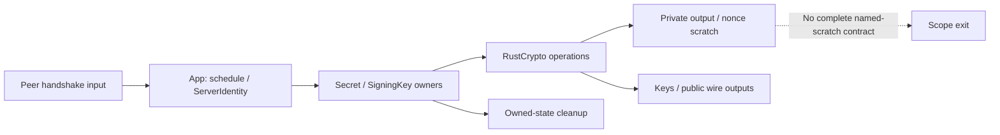
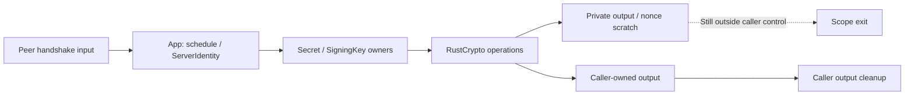
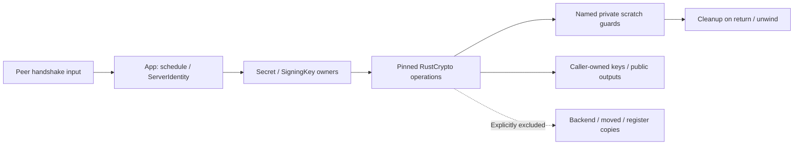
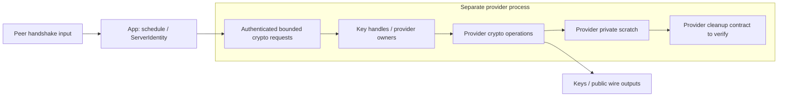

# Security Hardening Proposal: Assign erasure responsibility to the layer creating temporary secrets

## Decision

The decision is where to take responsibility for lifetimes of temporary outputs and nonces created by dependency functions,
in addition to the application's policy for erasing returned keys. I directly read application calls and pinned crate sources,
and took the fact that owning slots reside inside the library boundary as the starting point for this design.
The absence of explicit erasure here is a limitation of the cleanup contract, not proof of an observed disclosure vulnerability.

## Executive Recommendation

We compare **option 1: retain caller output cleanup**, **option 2: dependency-internal lifetime guards**, and **option 3: a separate provider
process**. Under the condition that current APIs and deployment structure are preserved, I recommend option 2.
We improve cleanup responsibility with small patches starting with digest/HMAC/HKDF, then handle named signing temporaries
in a separate phase. This recommendation implies neither remote exploitability, erasure of all copies, nor constant-time safety.

## Evidence

Observations come from directly reading the pinned sources below. The structural issue we infer is that application owners
cannot own dependency-local copies. New guards and APIs are proposals, not implemented facts.
The baseline revision is `47c80c75cc93934836b2893905752fb3f13a0c23`, and
dependency versions and archive integrity can be checked in the [hash list](../evidence/source-manifest.json).

| Evidence | Finding or document | What it establishes |
|---|---|---|
| app-owners | Application key owners and schedule | Caller/owner contracts in `protocol_rust/src/secret.rs`, `schedule.rs:31–55,69–79`, `identity.rs:37–79` |
| hash-scratch | digest fixed-output temporaries | full_res in digest 0.11.3 `src/block_api/ct_variable.rs:103–116` is a local output separate from state Drop |
| hmac-scratch | HMAC pad and inner hash | Local copies in hmac 0.13.0 `src/block_api.rs:53–68,81–89`, `src/utils.rs:9–31` |
| hkdf-scratch | HKDF output and prev | Ordinary output and previous block in hkdf 0.13.0 `src/lib.rs:94–96,135–165` |
| signing-nonce | Ed25519 seed digest and nonce | ed25519-dalek 3.0.0 `src/signing.rs:863–868,919–935`, `src/hazmat.rs:84–98` and curve 5.0.0 `src/scalar.rs:663–669` |
| backend-scratch | Intermediate scalar/point multiplication copies | curve 5.0.0 `src/scalar.rs:192,235–243,317–340,1159–1163`, u64 backend and radix digits |
| arm-traces | Existing OCI ARM collection | `protocol_rust/evidence/arm_secret_flow_20261108/review.json`: 70 functional tests, 160 collection runs, and incomplete approval |
| api-probe | Output type compilation control | [Positive/negative controls](../evidence/api-probe-result.json): slice guards compile; Array Zeroize bound is rejected |

We observed local variables and feature contracts in the sources. We did not measure how long those values
remain in runtime memory, whether remote inputs can read them, or how fast a new patch is.
The 134 existing ARM warnings are candidate classifications in authentication results, propagation, and CLOSE scope; they are not evidence of disclosure in this design.

## Current Design And Failure Mode

Peer handshake inputs invoke the key schedule and server authentication signatures. The application stores keys in Secret,
and ServerIdentity borrows the SigningKey inside a mutex through high-level try_sign. Close and signing use the same
mutex, so the new design can preserve this disposal/access boundary.

The application raw PRK is currently explicitly erased after copying; Secret and hash states also have Drop cleanup.
However, HMAC pad/inner hash, HKDF's entire one-block output, and digest full_res are
local values outside these owners. Production expand restricts N to 1..32 and actually requests 32/4 bytes,
but even a 4-byte output creates an internal 32-byte block. Using one block does not eliminate internal copies.

Signing presents the same issue at another layer. The seed expansion digest, clamped scalar bytes,
nonce r, and 64-byte reduction input are separate from ExpandedSecretKey's own Drop.
Scalar is Copy/Clone and provides Zeroize, but has no automatic-erasure Drop.
Even if we erase the owning slot of r, copies created by multiplication, reduction, and radix conversion must not be counted under the same contract.

## Desired Invariants

We define the following implementable and verifiable contracts.

- Registered secret temporaries are owned by private guards in their creating functions, which erase owning slots after last use on normal return, Result errors, and unwind.
- Output APIs distinguish caller-owned PRK/OKM from public wire tags/signatures. Internal scratch is not exposed to callers.
- Reduce unnecessary copies/moves of guarded values, without claiming guarantees for erasure of past copies/registers.
- Key owners, strict verification, wire format, and deterministic signatures are preserved; no suppression is added to hide cleanup failures.
- Backend scratch outside the registry remains incomplete; when new paths are introduced, register owners, exit paths, and tests first.

Rust Drop execution is not guaranteed on process abort, SIGKILL, or power loss. Unwind guarantees are
limited to the build's panic configuration and actual ownership scope.

## Constraints And Non-Goals

We do not change wire v0.1, KEM/signature algorithms, clamping, or nonce generation formulas. We also create no arbitrary-message signing or
public hazmat API. Adding Drop to public Scalar is excluded because it is incompatible with Copy and
changes broad APIs. Tests that locate and erase private dependency addresses from application wrappers or
read freed memory are also excluded.

The initial improvement scope is the specified owning slots. Past copies throughout scalar backends/hash compression,
registers, OS swap/core dumps, complete provider erasure, and timing/cache/speculation independence are separate matters.
External researcher review was not made a prerequisite for preparing this design.

## Before Architecture

We view the boundary between key owner and scratch cleanup responsibilities as follows.

Even when key owner cleanup finishes, the same contract does not extend to scratch termination.
This boundary requires distinguishing changes to caller types from changes to creating-function responsibility.

## Options

### Option 1: Retain caller output cleanup

We can preserve existing high-level APIs while protecting application raw PRK with RAII or adding
wrappers using output arguments. This option clarifies error paths for app-owned
buffers without dependency forks or backend changes. Since raw PRK already has normal-path cleanup,
the effect of the new improvement can be described within that narrow scope.

finalize_into may reduce moves of returned Arrays, but still calls the same
internal core that creates HMAC hash and digest full_res. HKDF prev and nonces are also inaccessible to callers.
Thus, while this option offers immediately available narrow protection, we cannot readily
recommend it as completing the internal-copy task. It requires no separate IPC or persistent allocation, but wrappers that
copy caller buffers can add cost and copies, so output arguments and existing owners should take priority.

Only small application changes need reverting; existing types and wire format are preserved. However, if future callers receive new return
outputs into ordinary arrays again, rules become scattered again. API documentation and compile-fail contracts
may reduce that recurrence risk, but still do not resolve dependency-internal cleanup responsibility itself.

| Change | Before | After | Security consequence | Cost |
|---|---|---|---|---|
| caller output | Explicit raw PRK erasure on the normal path | Caller RAII/output arguments | Error-path cleanup of app-owned values | Review output copies/lifetime APIs |
| Internal scratch | Library-local values | Same | HMAC/HKDF/nonce copies remain | No dependency maintenance cost |

If we choose this option, only caller outputs are completed. It is the simplest choice when accepting
a narrow contract that does not record internal copies as resolved.

### Option 2: Dependency-internal lifetime guards

We can use the fact that the function creating a value also knows its last use.
Place private guards in small source patches to pinned digest/hmac/hkdf and dalek/curve,
preserving existing public functions and cryptographic formulas. Handle the hash layer first, then named signing slots
in the next change, so regression causes do not overlap.

We cannot assume that Output Array itself satisfies the Zeroize bound under the current feature configuration.
A separate compilation control confirmed that a private guard erasing the slice of an owned value with AsMut<[u8]> is
feasible at the type level. Even when implementing this guard, we do not claim to clean past copies
moved during return. Where possible, initializing inside the guard and using finalize_into to write directly
to its owning slot reduces unnecessary moves.

The hash phase registers digest full_res, HmacCore pad/inner hash and long-key hash, and HKDF output/prev.
Use RAII rather than zeroize at the end of a simple function, so slots owned at the time are erased
even when a generic hash panics. Adding a new hkdf/zeroize feature requires hmac feature propagation and
explicit opt-in in both the application and fuzz manifests. Do not assume that existing hmac/zeroize alone automatically
enables the new HKDF feature. SimpleHmac/Reset variants must also be improved when broadening the contract,
or explicitly excluded from the initial patch.

The signing phase handles ownership scopes for the seed digest, scalar_bytes/clamping results, Scalar::from_hash digest output,
nonce r, and named key-dependent arithmetic results. Since an error in the second message
update callback can occur after r is created, error paths must also be handled through RAII.
The current pure try_sign callback always succeeds, so this error test uses internal fault injection
to check the generic path's cleanup contract.
We do not change public Scalar's Copy contract. Even ref operations can create unpacked limb and radix
copies, so the backend ledger remains separately incomplete.

Maintaining cleanup-only patches to stable-version sources has a cost. Source hashes, patch diffs,
licenses, feature matrices, and regular reapplication must be managed; this maintenance cost may change the choice
more than performance does. Cleanup writes are proportional to temporary buffer length, and scratch guards themselves require no new
IPC. Stack/heap peaks and latency effects depend on optimization results and have not yet been
measured. Until upstream inclusion, an implementation candidate is a small reviewable vendored patch
that does not directly modify the crates.io cache. Sending messages upstream or
submitting public patches is outside this design.

| Change | Before | After | Security consequence | Cost |
|---|---|---|---|---|
| Creating function | Ordinary local output/nonce | Private owning guard | Registered slot cleanup on return/error/unwind | Erasure writes, regressions, patch maintenance |
| caller API | Ordinary return outputs | Preserve existing API, optional additive into API | Clarify ownership transfer | Check default implementations/external trait compatibility |
| Backend boundary | Implicit expectation of full coverage | Explicit exclusion ledger | Prevent exaggerated erasure claims | Further backend review required |

This approach avoids scattering cleanup responsibility among callers. In return, reviewers must be able to find
the slots we guarantee in actual source/instructions. When reverting the patch,
revert path overrides, both lockfiles, and application APIs together, and mark the corresponding cleanup items incomplete again.

### Option 3: Separate provider process

A separate provider process can offer a stronger boundary for isolating long-term signing keys
from application memory-read risks. We can delegate transcript signing and required KDF operations through
authenticated restricted requests, keeping key handles and actual crypto processing in that process. This option's
greatest advantage is reducing the scope in which long-term keys reside in the application address space and centralizing
operational permissions and observability. Using an actual HSM/KMS first requires checking the product's Ed25519 support and
key lifetime contract; no product has yet been selected.

However, nonces/scratch in a separate process are not automatically erased. The provider source and
erasure contract must be validated again; KDF outputs returned to the application still need application ownership and cleanup.
Process termination also does not prove erasure of swap/core/OS physical memory. Merely replacing the library
with ring does not automatically close this guarantee gap either, so we do not count it as equivalent to this option.

This design introduces IPC serialization, additional copies, queues, timeouts, and restarts. The current serialization
contract between in-flight signing and close must move to revoke/ack rules across both processes; duplicate requests during retries and reuse of
discarded handles must be rejected. Only authorized handshake transcript requests should be accepted,
to avoid expanding into an arbitrary-message signing service. Even if KDF is moved, if KEM creates the shared secret in the application,
IPC copies of that value are added, requiring another data-flow review.

We can first introduce key handles and the provider protocol in an experimental environment, validate service
response correctness, and transition gradually. Rollback must not automatically fall back to another provider
on failure. It must return to a preselected application deployment version and discard provider key handles,
while explicitly documenting the change in security scope as the original application holds the seed again.
There is reason to reconsider this option if the isolation benefit becomes important enough to justify operational complexity.

| Change | Before | After | Security consequence | Cost |
|---|---|---|---|---|
| Key owner location | Application address space | Separate provider address space | Can isolate long-term keys from application memory reads | Deployment/authentication/observability/recovery |
| Calls | Local functions/mutex | Restricted IPC and revoke/ack | New authority boundary and failure states | Latency/copies/queues |
| Internal scratch | Current library-local values | Provider-internal values | Erasure contract requires revalidation | Provider audit and possible cleanup patches |

If the current goal is cleanup of the specified temporaries, creating a provider costs more than the direct solution.
It remains an option to consider when long-term key isolation becomes a separate goal.

## Comparison

The following are directions derived from source and validation plans, not measurement results. We compare
where costs arise, without selecting through a hidden single score.

| Dimension | Option 1 caller outputs | Option 2 internal guards | Option 3 provider |
|---|---|---|---|
| Security | Improves caller slots only, internals unaffected | Cleans registered internal slots, backend excluded | Application/long-term key isolation possible, provider scratch unverified |
| Performance | Possible additional output copies | Erasure writes, no IPC | Adds IPC/queues/serialization |
| Memory | Depends on caller buffer lifetimes | Depends on guard slots/optimization | Additional process/request buffers |
| Reliability | Preserves existing functions/errors | Generic unwind/error cleanup tests required | Adds timeout/revoke/restart states |
| Operability | Existing deployment | Maintain source patches/features | Adds provider operation/permissions/observability |
| Migration | Mainly application wrappers | Both locks/pinned patches/API compatibility | Handles/protocol/deployment transition |
| Ergonomics | Callers remember rules | Creating function owns responsibility | Centralized authority, complex call failure handling |
| Rollback | Revert application changes | Revert patches/locks/APIs together | Manage deployment/handles/key location changes |

We do not claim to have measured a performance advantage or quantified latency effect for option 2. The first
measurements should compare key schedule, signing, and actual handshake
p50/p95/p99, throughput, and stack/heap peaks between baseline and candidate on the same toolchain/CPU. With no prior budget,
we grant no performance approval without measurement.

## Recommendation

I recommend option 2 under the current conditions of preserving public APIs, wire format, and deployment boundaries. It is
the boundary closest to the source evidence that the values we want to clean are library-local.
Narrowing the first change to the hash layer and validating signing temporaries separately lets us
gradually expand erasure responsibility while preserving existing regression evidence.

If patch maintenance cannot be ensured, choose option 1 and leave internal scratch incomplete.
If isolating long-term keys from application memory reads becomes the primary requirement, the costs of option 3 become justified.
No option establishes erasure of all copies or security approval from taint warning count 0 or type Drop alone.

## Evidence Coverage And Residual Risk

Here, addresses/mitigates describe expected scope if the design is applied, not a determination that remediation is complete.
Existing owners, buffers, and strict memory assessment remain necessary in every option.

| Evidence | Option 1 | Option 2 | Option 3 | Remaining scope and direct improvements needed |
|---|---|---|---|---|
| app-owners — Application key owners | mitigates | addresses | mitigates | Preserve caller-owned key Drop and close serialization |
| hash-scratch — digest full_res | unaffected | addresses | unknown | Actual cleanup patch/validation required |
| hmac-scratch — pad/inner hash | unaffected | addresses | unknown | Specify Simple/Reset scope separately |
| hkdf-scratch — output/prev | unaffected | addresses | unknown | Cleanup of previous/final blocks and ignored PRK required |
| signing-nonce — digest/r | unaffected | mitigates | unknown | Improve named slots, then exclude backend |
| backend-scratch — limbs/digits | unaffected | unaffected | unknown | Separate ownership ledger/review for each backend |
| arm-traces — Existing functional/taint | unaffected | unaffected | unaffected | Rerun on new code, preserve original warning/99 |
| api-probe — Type feasibility | mitigates | mitigates | unaffected | Compilation is not actual wipe evidence |

Backend, past moves, registers, and memory of processes that do not terminate remain outside the coverage.
Existing 48-byte std/libtest entries and WSL AES-GCM results are also separate. We do not convert previous original evidence
into patch passes; constant_time_approved and production_memory_passed remain false.

## Migration And Rollout

First record upstream archives and small change diffs, and build from
reproducible pinned source paths. Do not edit installed Cargo caches or change only version strings to impersonate sources with existing checksums.
If path patches are used in implementation, check workspace boundaries for both the protocol manifest at the repository root and
the separate fuzz manifest, and validate both lockfiles/feature graphs.

After confirming that existing high-level function behavior and byte vectors are identical, the application's optional into API
can be connected. At no stage should crypto errors trigger automatic fallback to older versions or different algorithms.
Mark the implementation experimental until cleanup paths in release/audit builds are confirmed.

When reverting, restore dependency source patches, path overrides, both lockfiles, and calling APIs
consistently. Option 2 does not change key/state formats or wire format and therefore requires no data migration.
However, cleanup improvements disappear, so status documents and completion registries must also be reverted.

## Validation Plan

We assess correctness, cleanup, and residual risk separately. Record source, locks, features,
toolchain, CPU, and binary hashes before and after implementation; do not count 0 or missing tests as completion.

| Area | Validation and acceptance criteria |
|---|---|
| hash/HMAC/HKDF correctness | SHA256/512 known vectors, RFC4231 short/131-byte keys, generic HKDF 0·1·32·33·42·255×HashLen and oversized-length rejection/split-info, and RFC5869 vectors. 0 byte mismatches against existing vectors |
| Application KDF scope | Preserve schedule::expand's 1..32 limit and rejection of N=0·33, label.len()>u16::MAX. Distinguish from generic HKDF accepting 0·33 bytes |
| Public API compatibility | Features ON/OFF, explicit Hmac/Reset/Simple scope, external implementation compatibility review for new HmacImpl methods, such as default implementations. Preserve compilation of existing code |
| Signatures | RFC8032 §7.1 pure Ed25519, existing ring 40 pairs, message/signature tampering and disposal rejection; preserve current verify_strict canonical scalar/R, small-order A/R, and public key decode policies. No ctx/ph introduction |
| Cleanup observation | Wipe witnesses for live owning slots: normal, generic panic/unwind, and second update error after r creation. No reading after free; needs_drop alone cannot pass |
| Optimized instructions | Inspect target erasure writes/calls/source mapping in actual x86-64/ARM release/audit binaries. Do not generalize to backend/historical copies |
| Regressions/diagnostics | Python/C/Rust/docs/actual TLS, required ASan/fuzzing/taint positive controls. Preserve the original 134 contexts/48 bytes/exit99; review new unclassified warnings/usage errors |
| Resources/performance | Same toolchain/CPU, lengths 0·1·63·64·65·1024·16384 and actual handshakes. Baseline/candidate p50/p95/p99/throughput/stack/heap peaks; report repeated samples and noise ranges |

Functional/vector mismatches and new invalid access/leaks are not accepted. Existing unresolved warnings are
preserved separately. Quantitative performance deployment budgets remain undefined. If a regression outside baseline noise
is observed, performance approval is withheld until the cause is explained and a budget is set.
We do not count existing OCI ARM submissions or local x86-64 runs as new WSL runs.
Distinguish public key from_bytes ZIP-215 decoding from verify_strict rejection rules; this work does not
replace them with a full RFC8032 point-validation policy.

## Implementation Work Packages

The following are candidate work units for option 2; this document does not mark them implemented or finally selected.

**Hash-layer cleanup responsibility.** Add private guards in the order digest full_res → HmacCore pad/inner hash and long-key hash →
HKDF output/prev. Specify public generic API scope through HKDF prev replacement, final blocks,
and ignored PRK. Include Simple/Reset or
fix their exclusion in documentation and feature contracts. Generic callback unwind tests are required.

**Caller output APIs.** Optional HmacImpl::finalize_into and HKDF Extract::finalize_into/
extract_into are additive candidates. Preserve existing return APIs and external trait implementations,
and clean temporary outputs created by default implementations too. Applications can use a thin wrapper to write into heap-stable Secret<32>
directly. These into APIs do not replace internal guards.

**Named signing temporaries.** Assign ownership scopes to seed digest, scalar_bytes and clamped values, from_hash output,
nonce r, and key-dependent arithmetic results. Preserve public SigningKey::try_sign,
mutex owners, and strict verifiers. Do not remove public Scalar Copy/Clone or
rewrite the signing algorithm.

**Registry and evidence.** Connect each ledger entry below to before/after implementation source, exit paths, observed slots, instructions,
and validation results. Backend entries remain excluded unless separate completion conditions are met.
Record existence of a cleanup patch and confirmation of actual optimized erasure as different states.

| Ledger entry | Creation/ownership layer | Phase 1 target | Exclusions/cautions |
|---|---|---|---|
| digest full_res | CtOutWrapper | Owned output guard | Copies inside SHA compression are separate |
| HMAC pad/inner hash/long-key hash | HmacCore/utils | Normal/unwind cleanup | Specify Simple/Reset scope |
| HKDF output/prev/ignored PRK | GenericHkdf | Replacement/final-block/error cleanup | Test both production one-block and generic multiblock cases |
| Application raw PRK | schedule | Caller RAII/into candidate | Distinguish from internal cleanup |
| seed digest/scalar_bytes/clamped values | dalek | Clean named owning slots | Distinguish clamp_integer by-value copies |
| nonce digest/r/arithmetic results | curve/dalek | Clean registered slots | Internal unpacked arithmetic limbs are separate |
| scalar backend/radix digits | curve/backend | Excluded from phase 1 guarantee; follow-up ledger | Do not claim this is resolved by adding Scalar Drop |
| Stack before moves/registers/OS retention | compiler/runtime/OS | Excluded from guarantees | Cannot be proved by Drop/taint |

## Open Questions

Follow-up decisions are responsibility for maintaining/updating small dependency patches and performance budgets.
If upstream provides the same cleanup contract, we can move to that pinned version instead of maintaining our own patch.
Promoting complete scratch cleanup of selected CPU backends to a phase 2 goal also needs a separate decision.
Selecting provider isolation first requires concrete products, permissions, handle disposal, failure recovery, and latency budgets.
