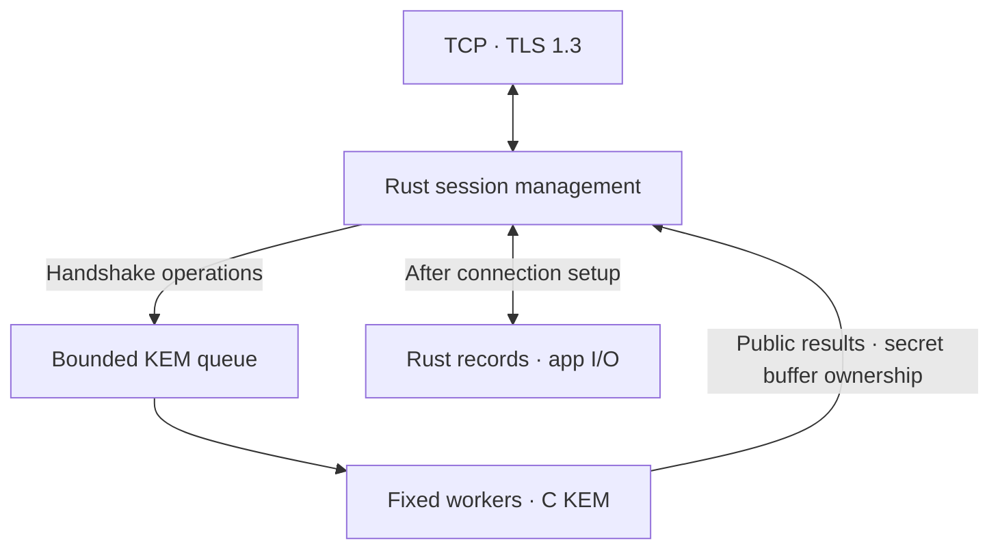

# Spiral OPT2 Rust–C Architecture Design v0.2

Written: 2026-11-06 · Status: pre-implementation design · Wire format: retain existing protocol v0.1

Rust owns networking, parsing, state, and records; the existing C KEM is called only during connection setup.
The data path contains no custom C KEM calls. KEM computation is isolated behind a bounded queue and fixed workers.
The goal is predictability of tail latency, memory usage, and secret cleanup after cancellation, as well as average speed.

The Rust components in this document have not yet been implemented. The passing results for the existing 69 Python protocol tests and 9 C checks
are not validation results for the Rust implementation. Complete memory erasure, constant-time behavior, and Spiral's cryptographic security are not guaranteed.

## 1. Design decisions

| Area | Owner | Rationale |
|---|---|---|
| TCP·TLS 1.3 | Rust / Tokio / rustls | Manage connections, deadlines, and admission limits in the transport layer |
| Frames·authentication·transcript·Finished | Rust | Consolidate canonical encoding and state transitions in one implementation |
| HKDF·HMAC·record AEAD | Rust API using a maintained cryptographic library | Avoid crossing a custom FFI boundary for each data item |
| KEM keygen / encaps / decaps | Existing C fixed profile | Reuse validated operations and defer the cost of an independent Rust port |
| C secret-key ownership | KEM worker that created the key | Avoid moving raw pointers across threads and concurrent deallocation |
| Application authentication | Upper layer after handshake | Distinguish channel server authentication from user identity authentication |

In-process FFI is not a security isolation boundary. C memory errors can affect Rust and other connections.
The default research configuration uses fixed in-process workers; deployments that require process-level fault isolation must compare separate KEM worker processes and IPC.
That case requires a separate design and measurements covering IPC copies, key transfer, and process restarts.

## 2. Compatibility with the existing protocol

Only the implementation language and internal execution structure change. Retain the following values and validation order.

- n=256, k=2, q=3329, eta=1, 32-byte shared secret.
- SKW1 public key 808 bytes, ciphertext 1160 bytes. No legacy autodetection or LAB mode.
- 40-byte frame header; existing message types, canonical encoding, signatures, transcript, and HKDF labels.
- ALPN `spiral-opt2/0.1`, exporter label `EXPORTER-SpiralOPT2-v0.1`, and existing exporter context.
- Certificate chain and server name validation, plus a separate server authentication key pin check. Retain suite, name, purpose, and exporter binding.
- Retain Spiral research records inside TLS 1.3. Retain the initial version's prohibition on resumption, 0-RTT, and automatic fallback.
- Do not deliver application data before Finished verification.

Call the rustls exporter after the TLS handshake completes. Allow only TLS 1.3 in configuration and specify policies for resumption, tickets, and early data.
The TLS implementation's KeyUpdate and Spiral record key lifetimes are separate. TLS KeyUpdate does not reset Spiral sequence numbers or limits.

The document version v0.2 does not imply a new wire version. Optimizations that change transmitted bytes require review of a new specification.

## 3. CPU work isolation and C key ownership

### 3.1 Worker model

Start with a default worker count W of `min(2, max(1, available_parallelism - 1))`, adjustable through configuration.
This does not exclusively reserve cores. Test with affinity and CPU quota taken into account.
Fix W at startup; do not keep creating threads as load increases.

Each worker is a dedicated Rust thread that calls the synchronous C API.
Tokio I/O tasks can continue handling sockets and other sessions while awaiting completion notifications.
Workers are not occupied while waiting for per-connection network responses.

Limit the global work budget to a total of 32 running and queued jobs. Implement the queue as a bounded channel.
Each session may have at most one queued or running KEM operation at a time. Decapsulation occurs once per key.
When the queue is full, fail new handshakes; established connections do not use the KEM queue for their record path.

### 3.2 Key handles

- The Rust type wrapping `sp_key *` is worker-local and provides no `Copy`, `Clone`, `Send`, or `Sync`.
- Store the server secret key produced by keygen in the worker's bounded key table. Return only the public key and an internal lease to the network layer.
- A lease includes worker number, slot, generation, and session identity. It is internal routing information, never sent on the wire or accepted as external input.
- On a decaps request, verify the lease and session, then remove and consume the key from the table first. Do not call C for a second request.
- Retain C's atomic 1-use restriction. Validate Rust ownership checks and the C restriction separately.
- `Drop` for the worker-local key type calls `sp_key_destroy`. Do not serialize C pointers or free them using Rust's `Box::from_raw`.

After sending the public key, the server keeps the key in the table while awaiting ClientKey; the worker handles operations for other sessions.
Limit retained secret keys within the pending handshake cap. Do not reuse them after success, failure, or timeout.

### 3.3 Cancellation and deadlines

An executing C function cannot safely be interrupted by cancelling an async task.
Even if the connection drops, do not free an executing job's inputs, outputs, or secret key from another thread.

1. Each session lease has a shared cancellation flag and an absolute deadline.
2. Check cancellation and deadline before execution; do not start unnecessary work.
3. If cancelled during execution, terminate the Rust network session, while the worker retains the buffers owned by the C job.
4. Recheck cancellation when C returns. Erase unneeded results and secret keys.
5. If the oneshot receiver is already gone, immediately erase the returned secret buffer through Drop as well.
6. Cancellation and expiration handling for retained keys must work even when the normal work queue is full. Use a shared cancellation flag and worker wakeup,
   checked by the worker between jobs and on its idle timer. Do not rely solely on placing cleanup requests in a full data queue.

A timeout sets the validity deadline for the connection and result. It does not forcibly interrupt native computation or guarantee immediate erasure at that point.
Handle abnormally nonterminating C jobs and process faults through supervisor-driven process restart. A restart does not restore existing connections;
start with new handshakes. Do not treat recovery and complete secret erasure as the same guarantee.

## 4. FFI contract and secret buffers

Retain four FFI operations: `sp_keygen`, `sp_encaps`, `sp_decaps_once`, and `sp_key_destroy`.
Do not cross the boundary for every field, coefficient, or hash invocation.
Do not link or expose C's test seed API in production builds.

| Value | Ownership | Lifetime |
|---|---|---|
| Public key·ciphertext | Rust fixed-length buffers with validated sizes | As needed for parsing, transcript, and transmission |
| KEM secret key | C allocation, Rust worker-local owner | Until 1 decapsulation or handshake failure |
| `ss` | Rust-owned fixed-size secret output buffer | Erased immediately after deriving PRK with HKDF-Extract |
| PRK·Finished keys | Rust secret types | Retained until the final v0.1 derivation/verification operation, then erased |
| Send·receive data keys | One owner in each direction's record state | Until session termination, failure, or usage limit |
| Plaintext | Single-owner app buffer | Erased after app processing, transmission completion, or queue disposal |

Have C write secret outputs directly into fixed-size heap buffers. Move only buffer ownership from worker to session,
without repeatedly copying secret arrays as function return values or message values. Do not expose raw `[u8; N]` as public fields.
Secret types provide no `Copy`, `Clone`, or content-revealing `Debug`, and call a validated zeroization function in Drop.
Do not unnecessarily duplicate app plaintext into strings, JSON, or logs.

FFI pointers are valid only during a call. Validate length, alignment, mutability, non-overlap, allocator, and ABI as part of the contract.
C does not free/realloc Rust buffers or retain pointers. Return secret-key deallocation to the C allocator.
Do not use callbacks, longjmp, or unwinding across language boundaries.

Internal state and expanded-key copies in HKDF, HMAC, and AEAD implementations also require separate erasure policies.
Do not assume that adding zeroize to an input buffer erases all internal copies in the cryptographic library.
Add `mlock` and dump exclusion if needed after testing support and cost; do not lock and unlock on every pass through the default packet path.

TLS and cryptographic libraries called from Rust may use C or assembly internally.
Here, 'no FFI in the data path' means that the application does not call its custom C KEM API for every record.

## 5. Records and I/O

An established session has one sender and one receiver. Each direction has one owner for sequence numbers, keys, and counters.
The session supervisor shares failure and termination state and ensures that failure in one direction invalidates the other direction as well.
Multiple app tasks submit requests through a bounded send queue; the app does not directly call nonce or record encryption functions.
Internal synchronization for splitting the TLS stream follows the chosen library's approach; eliminating all locks is not a goal.

Sending follows `take ownership from queue → check state and usage limits → reserve sequence number 1 time → AEAD → complete transmission`.
Do not send the next record in the same direction ahead of a record that has not yet been fully delivered to the socket.
After a partial write, retain the same already-encrypted frame and transmission offset. Do not re-encrypt or roll back the sequence number.
Discard the session on timeout or transmission error. Explicitly retain progress for cancellable I/O in async select.

On receive, complete the 40-byte header, check type, length, direction, session, and expected sequence number, then receive the payload.
Do not deliver plaintext to the app before AEAD tag verification. On failure, also erase the buffer being modified and mark the session failed.
Duplicate, missing, or out-of-order records terminate the connection; do not retry with that key and nonce.

Reuse send and receive buffers within a connection and review support for in-place AEAD.
Move secret buffer ownership when entering or leaving app queues. Initially, do not use a global plaintext buffer pool shared across sessions.
The goal is to reduce memory copies and system calls; full zero-copy including TLS and kernel buffers is not claimed.

Split app data into chunks of at most 16KiB. Data already ready in the queue may be written together within the limits,
but do not add a delay timer to fill a batch. Reconnection starts with fresh keys and sequence number 0.
Determine logical request retries through the app's idempotency policy; do not reuse encrypted frames.
Start with a continuous processing budget of at most 4 records or 64KiB, then yield the executor to give other connections a turn.
Place heavy app CPU work on a separate bounded execution path so it does not occupy KEM workers or socket I/O.

Prioritize CLOSE using a termination signal separate from the data queue. Finish the frame currently being transmitted, stop new DATA,
and erase queued plaintext. Handle TLS close_notify after authenticated CLOSE in both directions.
If the peer does not respond or the deadline expires, close the socket and discard state.

## 6. Initial resource limits

These settings inherit existing limits or provide a starting point for load tests. They are not measured maximum capacity or service SLOs.

| Item | Initial setting | Nature |
|---|---:|---|
| Active connections | 64 globally, 4 per actual peer IP | Retain existing policy |
| pending handshake | 32 globally | Retain existing policy |
| Connection token bucket | 1 per second per IP, burst 4 | Retain existing policy |
| KEM workers | Start with 1~2 using the formula above | New internal execution policy |
| Running + queued KEM jobs | 32 globally | New internal resource budget |
| KEM queue wait deadline | Minimum of 100ms and remaining handshake deadline | Provisional value for load tests |
| TLS handshake | Absolute deadline 10 seconds | Retain existing policy |
| Spiral handshake | Absolute deadline 10 seconds after TLS completion | Retain existing policy |
| ClientKey after ServerHello | Minimum of remaining deadline and 5 seconds | Retain existing policy |
| DATA plaintext | 1~16,384 bytes | Retain wire v0.1 |
| Maximum record frame | 40 + 16,384 + 16 = 16,440 bytes | Retain wire v0.1 |
| Session record count | Fewer than 2^20 DATA per direction, final sequence number reserved for CLOSE | Port existing checks and counters exactly |
| Cumulative DATA | 2^30−1 bytes per direction | Retain existing policy |
| Maximum key lifetime / idle | 600 seconds / 60 seconds | Retain existing policy |
| Shutdown grace | 2 seconds | Retain existing policy |
| App send·receive queues | 8 entries each, payload at most 128KiB each | New internal memory budget |
| TLS output buffer | Evaluate an explicit 64KiB setting as the starting point | Need to check rustls setting scope |

Bound queues by both entry count and byte count. When full, make producers wait; clean up the connection if the deadline expires.
Use one absolute deadline for queue waiting; do not restart it for each byte or message, so that a slow connection cannot extend it.
Authenticated CLOSE and error handling must not wait forever due to queue saturation.

The simple sum of 2 record I/O buffers and the app queue payload budgets above is 295,024 bytes per connection, approximately 288KiB.
For 64 connections, this is approximately 18MiB. This is not a process memory cap.
Measure actual RSS and peak usage including TLS internal buffers, kernel sockets, cryptographic providers, objects, allocators, and thread stacks.
The rustls output buffer limit also does not imply a total TLS memory limit.

## 7. Scope established by current measurements

Existing C implementation commit: `2877c9ceb7eb59518441d8f4f9b55813586d26bf` (PR #3).
While writing this document, each implementation received 30 warmup runs and 300 measured runs in the same process with CPU affinity 0.
Each run shuffled C/Python execution order using reproducible randomness and used a real RNG. There were no mismatches.

| Operation | C median(ms) | C p95(ms) | Python median(ms) | Python p95(ms) |
|---|---:|---:|---:|---:|
| keygen | 0.332501 | 2.183475 | 2.514843 | 7.409411 |
| encaps | 0.702055 | 3.019040 | 3.949576 | 9.263410 |
| decaps | 0.930324 | 3.256177 | 6.186873 | 14.584025 |
| Per-run sum of 3 operations | 2.425118 | 6.732153 | 13.054596 | 29.886961 |

The median of the sums differs from the sum of operation medians. The 3-operation sum compares time spent in the three KEM operations; it is not network handshake latency.
C measurements include Python ctypes calls and SKW1 processing costs. Python measurements return objects and exclude wire serialization.
C caller buffer allocation and the final key object free are outside the measured interval; secret data erasure inside decapsulation is included.
These measurements exclude Rust FFI, Tokio, TLS, concurrent connections, record AEAD, and cancellation cleanup.
Thus, these results are neither a Rust/C language comparison nor a measurement of final throughput.
The large gap between p95 and median requires remeasurement with CPU isolation and scheduling noise controlled.

Measurement source SHA-256:

- C: `ccb29fe8b1f428c25a93c8cb967f1090eea619ad36dcba7d53dc9bfaedc1cd0f`
- Python OPT2: `74c1ff02669d5b6eea87ccf650bc6930bc1822ffe8568fa68ce79fb29958a118`

The current C source uses O(n²) polynomial multiplication. Review integer Karatsuba, vectorization, and other options after profiling the share of time spent in multiplication.
Do not gain speed by changing parameters, wire compression, or randomness quality. Revalidate Python/C fixed vectors and fallback-key results for every operation optimization,
and repeat side-channel review for each compiler and CPU.

## 8. Implementation order and approval criteria

| Stage | Implementation scope | Completion criteria |
|---|---|---|
| A | FFI workers·leases·secret buffers·cancellation | Cleanup without UAF/double-free on invalid lengths, double consumption, cancellation during transmission, receiver disappearance, and timeout |
| B | Rust wire·state·key schedule·records | Match existing vectors, behavior corresponding to 69 checks, and additional queue saturation/partial I/O tests |
| C | TLS 1.3 and Python↔Rust integration | Verify real exporter, both roles, name/authentication failures, CLOSE, reconnection, and nonce rules |
| D | Load·latency·memory·fault tests | Collect p50/p95/p99, throughput, RSS, queue wait/rejection rate, and erasure latency after cancellation |

Test combinations use payloads 64B / 1KiB / 16KiB, concurrent connections 1 / 4 / 16 / 64, and KEM workers 1 / 2 / 4.
Exceeding the connection limit for one IP is a rejection test. Successful connection load uses multiple test peers or a separately documented test policy.
Do not hide the admission policy used in performance comparisons or confuse it with production defaults.

Measure per-connection p50/p95/p99 separately for TLS time, internal handshake, queue wait, C execution, HKDF/Finished, and app RTT.
Distinguish accepted load, saturation load, slow senders/receivers, and forced disconnections. Queues, key tables, and RSS must not keep growing under saturation.
If the initially proposed 100ms queue wait limit rejects normal load excessively, readjust it based on CPU workload and latency goals.

Also measure a TLS-only baseline under the same conditions to isolate the added costs of the Spiral handshake inside TLS and double record encryption.
Do not disable TLS or AEAD on the research integration path for these tests.
Review optimizations based on repeated results under the same functionality, security policy, and build conditions.
Do not apply changes that break sequence number, authentication, or key cleanup rules, or cause p95/p99 regressions unexplained by measurement noise.

## 9. Errors, recovery, and builds

Classify internal errors as InvalidInput / UsedKey / CryptoFailure / QueueFull / Deadline / TransportFailure, without logging secret values.
Do not return valid flags, decrypted messages, or detailed C errors to remote peers. Uniform error wording is separate from timing side-channel mitigations.
Use fresh TLS and KEM keys on reconnection. Do not restore old memory, keys, or nonces during process recovery.
Default logs contain only latency histograms, sizes, public state transitions, and error aggregates; disable key logging.

Split modules into wire, session, record, transport, kem-sys, kem-worker, secret, and bench.
Limit handwritten unsafe code to the kem-sys boundary and necessary narrow memory wrappers; prohibit unsafe in parsers, state, and record code.
Prioritize evaluating a configuration that statically links C KEM objects into the final binary. Finalize the build after comparing performance and tool compatibility with the current .so.
Record OpenSSL, TLS provider, Cargo.lock, C compiler options, and artifact hashes.
Include native implementations used by the TLS provider in dependency review; do not replace C RNG or SHAKE with arbitrary custom implementations.

Use Linux x86-64 as the first validation target. Support Windows and other CPUs after separate ABI, memory erasure, constant-time, and performance validation.
Preserve reference Python/C sources and public test vectors as comparison baselines.

## 10. References

- [C research implementation PR #3](https://github.com/1xvn/Spiral-KEM/pull/3)
- [Existing C validation results](https://github.com/1xvn/Spiral-KEM/blob/2877c9ceb7eb59518441d8f4f9b55813586d26bf/native_research/VALIDATION_2026-11-06.json)
- [Rustonomicon: FFI](https://doc.rust-lang.org/stable/nomicon/ffi.html): ABI, pointers, deallocation, and unwind boundaries.
- [Tokio: spawn_blocking](https://docs.rs/tokio/latest/tokio/task/fn.spawn_blocking.html): CPU work isolation, concurrency limits, cancellation limitations for running tasks, and dedicated threads.
- [Tokio: bounded mpsc](https://docs.rs/tokio/latest/tokio/sync/mpsc/fn.channel.html): bounded channels and backpressure.
- [rustls: ConnectionCommon](https://docs.rs/rustls/latest/rustls/struct.ConnectionCommon.html): exporter, TLS I/O, and output buffer limits.
- [zeroize](https://docs.rs/zeroize/latest/zeroize/): preventing erasure optimization and limitations involving copies and registers.
- [glibc: Erasing Sensitive Data](https://sourceware.org/glibc/manual/latest/html_node/Erasing-Sensitive-Data.html): scope of erasing designated memory.
