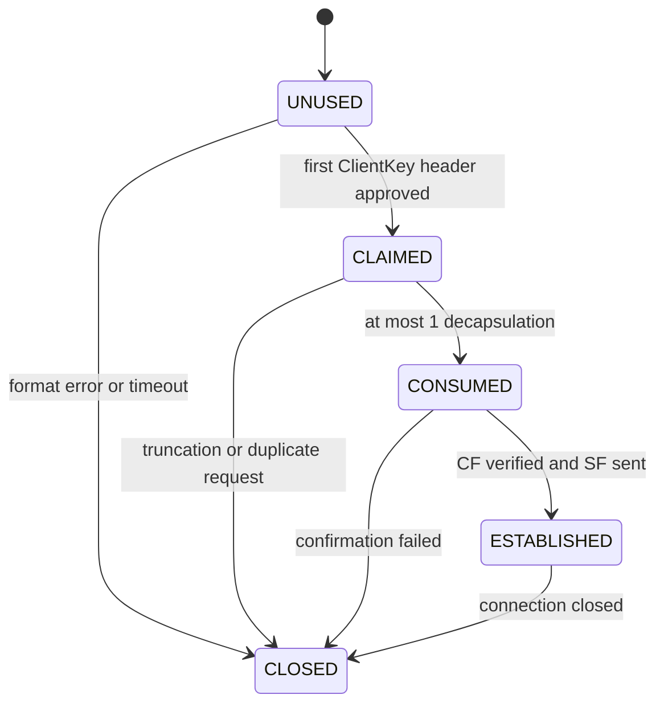

# Spiral OPT2 Communication Protocol v0.1 Design

Written on 2026-11-05. Document status: **draft research specification for implementation**. The KEM uses Spiral 0.3.1 opt2; 0.1 in this document is a separate communication protocol version.

This document fixes the requested draft's message bytes, server authentication, key derivation, state transitions, input limits, and test criteria. Design choices are recorded in the baseline profile below. The included verifier checks bytes and cryptographic operations without a network. Tests of actual TLS connections, a protocol server, concurrency, and interoperability between two independent implementations have not yet been performed.

## 1. Baseline Profile and Protection Scope

| Item | Choice in v0.1 |
|---|---|
| Runtime environment | Local native client and server, default listening address 127.0.0.1 or ::1 |
| Transport | Ordered byte stream over TLS 1.3 with authentication verified |
| TLS termination | Terminates directly within the same security boundary as the Spiral server |
| Connection binding | Include the current TLS connection's 32-byte exporter in ClientHello for the server to compare |
| Additional server authentication | Fixed list of previously trusted Ed25519 public keys |
| Client authentication | This handshake does not authenticate the client's identity. User permissions are granted through separate application authentication. |
| KEM | Spiral 0.3.1 opt2, n=256, k=2, q=3329, eta=1, key_bytes=32 |
| Wire format | SKW1 public key of 808 bytes, ciphertext of 1,160 bytes |
| Key derivation and Finished | HKDF-SHA256, full 32-byte HMAC-SHA256 |
| Data protection | ChaCha20-Poly1305, 32-byte key, 12-byte nonce, 16-byte tag |
| Key use | Fresh KEM key per connection, at most 1 decapsulation per server secret key |
| Connection lifetime | Full handshake for each new connection. Early data, resumption, renegotiation, and automatic fallback are not supported. |

Ed25519 is selected for the server authentication key. No post-quantum authentication rating is assigned to this profile. Security proofs and side-channel defenses for the Spiral parameters and protocol composition require separate review. TLS provides authentication and transport protection for actual services; the Spiral component is limited to research environments.

The baseline attacker can connect, disconnect, replay, and submit malformed messages. Code execution inside the server process, arbitrary memory reads, function hooking, and cache observation privileges are treated as separate threats. This protocol provides no guarantee against compromise of the local host itself.

### 1.1 Deployment Boundaries

TLS certificate chain, server name, and validity-period verification must pass. When using a local certificate, the relevant CA or certificate must be placed in the trust store in advance. Options to disable verification are not allowed. The application's intended server name must match both the TLS verification name and the ClientHello name.

The actual TLS ALPN bytes are ASCII `spiral-opt2/0.1`. This is an identifier for local experiments; no IANA registration is claimed. Terminate if the selected ALPN differs. TLS early data and session resumption are also disabled in this profile; terminate if the connection was resumed.

After TLS completes, use the results of the following library API. Do not reimplement TLS internal computations.

```text
channel_binding = TLS-Exporter(
    label = ASCII("EXPORTER-SpiralOPT2-v0.1"),
    context = empty bytes,
    length = 32
)
```

Use the regular exporter, not the early exporter. An implementation that cannot obtain the exporter must not start a v0.1 connection. Substitution with constants, random values, or session IDs is prohibited. The server compares the received value with the value computed on its own connection using a constant-time comparison API.

This choice prevents direct use in ordinary browser JavaScript or with CDNs and reverse proxies that terminate TLS elsewhere. Such environments require a separate profile defining channel binding and trust boundaries again. The exporter input in the included Python verifier is a public synthetic test value.

## 2. Fixed Identifiers and Byte Rules

| Name | Value |
|---|---|
| PROTOCOL_ID | ASCII `SpiralOPT2-Proto-v0.1`, 21 bytes |
| Protocol version | uint16 0x0001 |
| Research suite | uint16 0xF001 |
| Frame magic | ASCII `SPK1`, hex 53 50 4b 31 |
| Client direction | uint8 0 |
| Server direction | uint8 1 |
| Reserved flags | uint16 0 |

suite 0xF001 is an identifier within this protocol. Its namespace is separate from TLS cipher suite numbers. This suite fixes KEM, SKW1, Ed25519, SHA256, HKDF, HMAC, and ChaCha20-Poly1305 to the combination in the table above. Changing any of these requires assigning a different suite or protocol version.

All external integers are unsigned big-endian. The widths of uint8, uint16, uint32, and uint64 are 1, 2, 4, and 8 bytes, respectively. `||` denotes byte concatenation. Integer truncation, wrapping, and alternative representations are not allowed.

```text
U16(x) = 2-byte big-endian representation of x
U32(x) = 4-byte big-endian representation of x
U64(x) = 8-byte big-endian representation of x
V16(b) = U16(len(b)) || b
V32(b) = U32(len(b)) || b
DS(label) = PROTOCOL_ID || 00 || V16(ASCII(label))
H(b) = SHA256(b)
```

Strings are sent as the specified ASCII bytes without a trailing NUL, BOM, or whitespace. Only the `00` in DS is an explicit separator. v0.1 has no additional extensions, padding, compression, or optional fields. Reject trailing bytes, incorrect lengths, duplicate fields, and unknown message types.

The existing 12-bit coefficient packing inside SKW1 is preserved exactly as in the original source. Do not apply the external big-endian rule inside SKW1 or change the legacy serialization of KEM internal hashes.

### 2.1 Source and Profile Checks

The reference source is `spiral_kem_toy_v031_opt2.py`, with the following SHA-256.

```text
74c1ff02669d5b6eea87ccf650bc6930bc1822ffe8568fa68ce79fb29958a118
```

This hash identifies the test subject. It does not itself imply security. When reading wire data, use only KEM objects created through the normal API with the baseline profile fixed. Do not allow headers to enable LAB mode or select parameters.

| SKW1 object | Exact 8-byte prefix |
|---|---|
| Public key | 53 4b 57 31 50 06 00 00 |
| Ciphertext | 53 4b 57 31 43 06 00 00 |

All coefficients must be at least 0 and less than 3329. Reject values in 3329~4095 even though they fit in 12 bits. Do not automatically guess legacy formats or retry with another decoder after failure.

## 3. Common Frame Header

A frame is exactly `40-byte header || payload`. The length field counts only the payload, including the 16-byte tag for encrypted records. TLS record boundaries and Spiral frame boundaries are independent. The receiver must collect the exact number of bytes to reconstruct one Spiral frame.

| Offset | Field | Width | Rule |
|---:|---|---:|---|
| 0 | magic | 4 | SPK1 |
| 4 | version | 2 | 0x0001 |
| 6 | type | 1 | Type table below |
| 7 | direction | 1 | 0 or 1, matching the connection role |
| 8 | suite | 2 | 0 for ClientHello, 0xF001 afterward |
| 10 | flags | 2 | 0 |
| 12 | session_id | 16 | All 0 for ClientHello, ServerHello's value afterward |
| 28 | sequence | 8 | Handshake or data sequence number |
| 36 | payload_length | 4 | Read and allocate only after checking the range below |

| type | Message | Direction | Payload bytes | Handshake sequence number |
|---|---|---|---:|---:|
| 0x01 | ClientHello | C→S | 75~418 | 0 |
| 0x02 | ServerHello | S→C | 940 | 0 |
| 0x03 | ClientKey | C→S | 1,192 | 1 |
| 0x04 | ServerFinished | S→C | 32 | 1 |
| 0x10 | DATA | Both directions | 17~16,400 | Separate record sequence number |
| 0x11 | CLOSE | Both directions | 17 | Separate record sequence number |

The server generates session_id as a fresh 16-byte CSPRNG value. Regenerate it if it is all 0 or collides with the ID of a currently live connection. Do not look up or share keys using a session_id received on another connection. The TLS connection object owns the session.

Upon receiving a header, first check state, direction, type, constants, and length. For a message unexpected in the current state, terminate the connection before processing the payload or calling the KEM. Even when the length matches, perform transcript, authentication, and state checks separately.

## 4. Handshake Messages

### 4.1 ClientHello

| Order | Field | Representation |
|---:|---|---|
| 1 | client_random | Fresh CSPRNG 32 bytes |
| 2 | channel_binding | Current TLS exporter 32 bytes |
| 3 | version_count | uint8, 1~8 |
| 4 | offered_versions | version_count uint16 values |
| 5 | suite_count | uint8, 1~8 |
| 6 | offered_suites | suite_count uint16 values |
| 7 | server_name | V16, content of 1~253 bytes |
| 8 | service | uint8 length, content of 1~64 bytes |

Both lists are in ascending numerical order; duplicates and 0 are not allowed. The baseline v0.1 client lists are `[0x0001]` and `[0xF001]`. Even if other identifiers are present, the server may select only the version and suite in this specification, and terminates if either is absent from its list. Version 0x0001 in the message header identifies the current byte grammar.

server_name is a lowercase ASCII DNS A-label representation and must match the name used for TLS authentication. Each label is 1~63 bytes, comprising alphanumeric characters and internal hyphens; leading or trailing hyphens and a final dot are not allowed. IP literals are not allowed in this profile. Convert user-entered internationalized names before transmission; the receiver must not normalize the wire value again into another name.

service must match the regular expression `[a-z0-9][a-z0-9._/-]{0,63}`. The default research service name is `spiral-research`. The server verifies that the name and service are registered in local configuration and that the configuration matches the connection's TLS name.

The server starts KEM key generation and signing only after checking format, allowlists, name, service, channel_binding, and resource limits.

### 4.2 ServerHello

| Payload offset | Field | Width |
|---:|---|---:|
| 0 | selected_version | 2 |
| 2 | selected_suite | 2 |
| 4 | server_random | Fresh CSPRNG 32 |
| 36 | server_auth_key_id | 32 |
| 68 | kem_public_key_skw1 | 808 |
| 876 | server_signature | 64 |

selected_version and selected_suite are 0x0001 and 0xF001, respectively, and must match the header and ClientHello offers. Generate fresh public and secret keys for this connection. Do not reuse secret keys, matrix seeds, secret seeds, or fallback-key secret values across connections.

The signing key identifier is `SHA256(Ed25519 raw public key 32 bytes)`. The client looks up the previously trusted key for `(server_name, service, key_id)` in local configuration. The server does not send the raw authentication public key or certificate chain in this message. Do not automatically register a new key on the first connection that presents it. Key additions and revocations are handled through authenticated configuration distribution outside the connection.

Compute the signature by passing the following bytes unchanged to the pure Ed25519 API. Do not substitute the Ed25519ph variant.

```text
CH = complete ClientHello frame
SH_header = actual 40-byte ServerHello header with payload_length of 940
SH_core = first 876 bytes of the ServerHello payload
signature_input = DS("server-signature") || V32(CH) || V32(SH_header || SH_core)
server_signature = Ed25519.Sign(server_auth_private_key, signature_input)
SH = SH_header || SH_core || server_signature
```

The actual ServerHello header has payload length 940 from the start, including the 64-byte signature. Do not change this length to 876 when computing the signature. The complete ClientHello includes the name, purpose, offered lists, and TLS connection binding value, so these values are also signed.

The client checks selected values, session_id, pin match, signature, and canonical public key format, then performs encapsulate exactly once. On failure, close the connection without retrying a weaker suite.

### 4.3 ClientKey and Client Finished

The ClientKey payload is `SKW1 ciphertext 1160 bytes || client_finished 32 bytes`. The header's payload_length is always 1192. The transcript used for Finished is defined as follows.

```text
CK_header = actual 40-byte ClientKey header with payload_length of 1192
CT = first 1160 bytes of the ClientKey payload
T0 = CH || SH || CK_header || CT
h0 = SHA256(T0)
hs_prk = HKDF-Extract-SHA256(salt=h0, IKM=ss)
cf_key = Expand(hs_prk, "client-finished", 32, h0)
sf_key = Expand(hs_prk, "server-finished", 32, h0)
CF = HMAC-SHA256(cf_key, DS("client-finished") || h0)
CK = CK_header || CT || CF
```

ss is the shared secret of exactly 32 bytes obtained by the client from encapsulate. The server inputs the 32 bytes returned by normal decapsulate into the same key derivation. Do not specially reject shared secrets with particular bit patterns or distinguish normal keys from fallback keys. Terminate with an internal error on type or length mismatch.

Terminate on ciphertext format errors during input validation. Even if the format is valid but the reencryption check fails, verify CF using the fallback key returned by normal decapsulate. Use a constant-time comparison API for CF and terminate on failure. Do not pass the internal valid flag or recovered message across the call boundary.

### 4.4 ServerFinished and Data Keys

After verifying CF, the server computes the following values. SF_header is also the complete actual transmission header.

```text
SF_header = header with type=0x04, direction=1, sequence=1, payload_length=32
T1 = CH || SH || CK
h1 = SHA256(T1 || SF_header)
SF = HMAC-SHA256(sf_key, DS("server-finished") || h1)
ServerFinished = SF_header || SF
T2 = T1 || SF_header || SF
h2 = SHA256(T2)
master = Expand(hs_prk, "application-master", 32, h2)
c_key = Expand(master, "client-data-key", 32, h2)
s_key = Expand(master, "server-data-key", 32, h2)
c_prefix = Expand(master, "client-nonce-prefix", 4, h2)
s_prefix = Expand(master, "server-nonce-prefix", 4, h2)
```

The server enters the data state after successfully sending the entire ServerFinished frame in order. The client enters after verifying the ServerFinished header and MAC. Even if temporary keys were computed earlier, do not provide them to the application or use them for data processing before verification. Completing the protocol connection does not mean the user has logged in; operations requiring permissions need separate user authentication.

### 4.5 Exact Definition of HKDF info

```text
INFO(label, L, transcript_hash) =
    V16(PROTOCOL_ID)
    || U16(0x0001)
    || U16(0xF001)
    || V16(ASCII(label))
    || U16(L)
    || transcript_hash

Expand(prk, label, L, transcript_hash) =
    HKDF-Expand-SHA256(prk, INFO(label,L,transcript_hash), L)
```

transcript_hash is exactly 32 bytes and is h0 or h2 as specified by the procedure above. Output length L is also included in info. Use a standard HKDF library; do not mix in HKDF's internal counter or TLS's separate HKDF-Expand-Label format.

| Exact ASCII content of label | Length L | root | Context |
|---|---:|---|---|
| client-finished | 32 | hs_prk | h0 |
| server-finished | 32 | hs_prk | h0 |
| application-master | 32 | hs_prk | h2 |
| client-data-key | 32 | master | h2 |
| server-data-key | 32 | master | h2 |
| client-nonce-prefix | 4 | master | h2 |
| server-nonce-prefix | 4 | master | h2 |

## 5. State Transitions and 1-Time Use of Secret Keys

### 5.1 Client

| Current state | Allowed event | State after processing |
|---|---|---|
| TLS_PENDING | TLS authentication, ALPN, and exporter checks complete | SEND_CH |
| SEND_CH | ClientHello completely sent | WAIT_SH |
| WAIT_SH | Complete ServerHello validation succeeds | SEND_CK |
| SEND_CK | ClientKey completely sent using the result of 1 encapsulate | WAIT_SF |
| WAIT_SF | ServerFinished verification succeeds | ESTABLISHED |
| ESTABLISHED | Valid DATA | ESTABLISHED |
| ESTABLISHED | CLOSE, usage limit, or shutdown request | CLOSING |
| CLOSING | Bidirectional closure confirmed or shutdown timeout elapsed | CLOSED |
| Any state | Invalid event, authentication failure, timeout, or internal exception | CLOSED |

If any part of ClientKey transmission fails, do not retransmit on that connection. Do not carry encapsulate results, shared keys, or nonce state from a failed connection into a new one.

### 5.2 Server

| Current state | Allowed event | State after processing |
|---|---|---|
| TLS_PENDING | TLS, ALPN, and exporter conditions checked | WAIT_CH |
| WAIT_CH | ClientHello validation and resource allocation succeed | SEND_SH |
| SEND_SH | ServerHello completely sent using a fresh KEM key | WAIT_CK_UNUSED |
| WAIT_CK_UNUSED | Approve first ClientKey header and atomically claim use | CK_CLAIMED |
| CK_CLAIMED | Exact payload and SKW1 checks complete, at most 1 decapsulate and successful CF verification | SEND_SF |
| SEND_SF | ServerFinished completely sent | ESTABLISHED |
| ESTABLISHED | Valid DATA | ESTABLISHED |
| ESTABLISHED | CLOSE, usage limit, or shutdown request | CLOSING |
| Any state | Retry, duplicate CK, authentication failure, EOF, timeout, or exception | CLOSED |

The transition from WAIT_CK_UNUSED to CK_CLAIMED must be guaranteed through atomic ownership such as a lock or compare-and-swap. Approving a valid ClientKey frame header consumes the use allowance, even while waiting for the payload. Do not return the state to UNUSED if the payload is later truncated or malformed. No other task may process the same key concurrently.

One read task and one ordered write task own a connection. Do not let multiple parsers read the same stream or pass the same secret key to multiple workers. Even on asynchronous cancellation, do not reassign a key before an already-started decapsulation finishes. Subsequent callbacks for a closed connection cannot revive its state.

Release the server KEM secret key reference immediately after the normal decapsulate call finishes. Afterward, process Finished using only ss and the transcript. On error or closure, release references to the secret key, ss, hs_prk, Finished keys, master, directional keys, and exporter. Python reference release alone does not guarantee reliable memory erasure; if this property is required, review the implementation and storage separately.



These rules restrict paths for repeatedly querying the same key. Earlier cache experiments used thousands of queries against the same key and instrumentation at internal function boundaries. Leakage possible in a single execution, other privilege models, and side channels in the Python implementation still require review.

## 6. Data Records

Handshake sequence numbers and data record sequence numbers are separate. After reaching ESTABLISHED, both sides start directional send_sequence and receive_sequence at 0. DATA and CLOSE share a single record sequence space in each direction.

```text
nonce = direction_prefix[4] || U64(sequence)
AAD = complete actual common header of 40 bytes
payload = ChaCha20-Poly1305.Encrypt(direction_key, nonce, plaintext, AAD)
frame = AAD || payload
```

DATA plaintext length is 1~16384 bytes, and the payload is exactly 16 bytes longer. Empty DATA, padding, and additional tag formats are not allowed. DATA plaintext consists of application-defined bytes; this document adds no semantics such as login or command execution.

The receiver checks the current connection's version, suite, session_id, direction, type, length, and next expected sequence number before verifying AEAD. Only plaintext with a valid tag is passed to the application, at which point sequence numbers and cumulative usage are updated. Duplicates, gaps, out-of-order records, and tag errors terminate the connection. Do not skip frames or try decryption with multiple nonces to align sequence numbers.

A single write queue owns transmission. Atomically reserve the sequence number before encryption and never reuse it afterward. Send completed frames in that order. Encryption exceptions, partial writes, and failures with uncertain retry status terminate the entire connection and require a fresh start with new keys. Do not roll back an already-used sequence number.

### 6.1 Fixed Limits per Direction

| Item | Maximum |
|---|---:|
| Single DATA plaintext | 16 KiB |
| Total encrypted records, including CLOSE | 2^20 |
| DATA records | 2^20−1 |
| Cumulative DATA plaintext | 2^30−1 bytes |
| Plaintext budget reserved for CLOSE | 1 byte |
| Session lifetime | 600 seconds after ESTABLISHED |
| Idle time without a fully sent or verified received record | 60 seconds |

Reserve record sequence number 2^20−1 exclusively for CLOSE; terminate if DATA is sent or received with this sequence number. Stop new DATA and send CLOSE when processing one more DATA record would exceed byte, record, or time limits. These values were chosen as research operating limits and do not quantify certified security strength. The TLS library must also obey TLS's separate key usage limits.

v0.1 has no KeyUpdate. After reaching usage limits, perform the full TCP, TLS, and Spiral handshakes again. Connection retries and application request retries are separate. Automatic replay of requests with side effects is not allowed; applications must define authenticated request IDs and duplicate-handling policies as needed.

## 7. Closure, Errors, and Resource Limits

### 7.1 Authenticated CLOSE

CLOSE plaintext is one reason uint8. 0 means normal closure, 1 a time limit, and 2 a usage limit. The payload totals 17 bytes: 1 byte of ciphertext and a 16-byte tag. Unknown reason values are protocol errors.

Both sides maintain separate send_closed and receive_closed states. On a local shutdown request, prevent new DATA from being enqueued, send already-approved DATA in order, and then send one CLOSE. Do not send DATA or a second CLOSE in that direction afterward.

Upon receiving a valid peer CLOSE, set receive_closed and block new local DATA. After finishing already-approved local transmissions, respond with CLOSE(reason=0) if CLOSE has not yet been sent. The side that sent its CLOSE first may receive valid DATA sent before the peer CLOSE in order. Any record in the same direction after peer CLOSE is an error.

After confirming CLOSE in both directions, perform the TLS library's normal shutdown procedure. Disconnect if shutdown is not complete within 2 seconds of the earlier of sending the first local CLOSE or receiving peer CLOSE. Record EOF or TLS shutdown without Spiral CLOSE as a truncated session. Application policy determines the status of individual requests already completed; no completeness claim is made for the entire stream.

On authentication, format, or state errors, terminate the connection without sending detailed inner error messages. Do not use errors as signals to retry AEAD verification or send distinguishable responses for fallback-key check results. Delegate TLS-level alerts and connection cleanup to the maintained TLS library.

### 7.2 Fixed Limits for the Experimental Server

| Item | Default limit |
|---|---:|
| Total connections | 64 |
| Connections from the same actual peer IP | 4 |
| TLS connection attempts from the same peer IP | Token bucket of 1 per 1 second, burst 4 |
| Concurrent KEM operations | 2 globally |
| Pending inner handshakes | 32 globally |
| TLS completion deadline | 10 seconds from TCP acceptance |
| Overall inner handshake deadline | 10 seconds from TLS completion |
| ClientKey wait deadline | 5 seconds from complete ServerHello transmission, capped by the overall deadline |
| Inner receive frame buffer | At most 16,440 bytes |

Measure all deadlines with a monotonic clock; do not extend them with each arriving byte. Queue waiting and CPU computation time count toward deadlines. IP accounting uses the actual socket peer and does not trust proxy headers received in messages. Count IPv4-mapped IPv6 representations as the same IP. Local policy may only make limits stricter; peers cannot increase them through messages.

### 7.3 Secrets and Logs

Store the server's long-term Ed25519 key separately from ephemeral KEM keys and restrict access. Manage client pin configuration, including name, service, key_id, public key, and availability period, outside the connection. Distribute new keys in advance when rotating keys and reject revoked key IDs. Do not automatically share authentication keys with TLS keys.

Default logs record only local connection identifiers, states, success/failure categories, and cumulative usage. Do not log ss, keys, seeds, recovered messages, fallback_secret, valid flags, TLS exporters, authentication tokens, or raw payloads. Produce raw research data only in separate verification runs using public test keys, and keep it separate from operational logs.

## 8. Implementation Components and Completion Criteria

| Component | Responsibility | Completion criteria |
|---|---|---|
| TLS adapter | Authentication, ALPN, exporter, exact byte stream | Matching exporters at actual TLS endpoints; reject invalid authentication, ALPN, and resumption |
| Frame codec | 40-byte header and canonical payload | Handle all boundary sizes, fragmented reception, and reception of combined frames |
| Handshake state | Role, state, deadline, 1-time key use | KEM call counter at most 1 for duplicate and concurrent ClientKey |
| KEM adapter | Fixed profile, SKW1, normal decapsulate | Match original source and test vectors; reject LAB and legacy |
| Trust store | Name, service, pins, key revocation | No new pins from messages; reject revoked keys and different names |
| Key schedule | Transcript, HKDF, Finished | Match appendix h0, h1, h2, and all output bytes |
| Record state | Directional keys, sequence numbers, limits, closure | Nonce uniqueness; no sequence-number reuse after failure or cancellation |
| Application gate | User authentication, permissions, request deduplication policy | Channel completion alone does not establish authenticated user status |

### 8.1 Required Negative Tests

| Test group | Input or event | Expected result |
|---|---|---|
| Authentication | Wrong CA, server name, service, pin, signature, or revoked key | Terminate before KEM encapsulate |
| Connection binding | Exporter from another TLS connection, constant 0, or truncated value | Terminate before server keygen |
| Negotiation | Selection absent from offers, 0, duplicate list, or missing supported item | Terminate without automatic fallback |
| Parser | magic, flags, direction, length, trailing bytes, truncated field, or unknown type | Terminate with bounded allocation |
| KEM format | SKW1 P/C confusion, profile 1~5, legacy, or coefficient 3329/4095 | Terminate in normal input validation |
| Transcript | Replace ClientHello, public key, session_id, ciphertext, or CK/SF header | Signature or Finished failure |
| Key confirmation | Forged CF/SF, role reflection, or missing Finished | Cannot enter ESTABLISHED |
| State and concurrency | Duplicate CK, simultaneous CK, exception, cancellation, or late callback | At most 1 decapsulate per key; no session revival |
| Early data | Dispatcher observes DATA before Finished verification | Terminate without processing or forwarding |
| Record | Change tag, AAD, direction, or session; duplicate, skip, or reorder sequence numbers | Terminate without delivering plaintext |
| Limits | 16 KiB boundary, reserved sequence number, cumulative bytes, or timeout | CLOSE with the remaining budget or error termination |
| Closure | Forged or duplicate CLOSE, subsequent DATA, EOF, or unresponsive peer | Closure or truncation classification as specified |
| Restart | Server/client restart or reconnect after partial transmission | Fresh TLS, KEM, data keys, and sequence space |
| Request semantics | Replay request with side effects after response loss | Apply application deduplication policy |

Message parser fuzzing, state-based fuzzing, concurrency and load tests, inspection of secret references on closure and exception paths, and side-channel evaluation on actual platforms must follow. Interoperability may be recorded as verified only after independently written client and server implementations pass the same vectors and network tests.

## 9. Provided Offline Test Materials

| File | Contents |
|---|---|
| test_vectors_v0.1.json | Public test seeds, synthetic exporter, keys, complete frames, hashes, HKDF, Finished, and AEAD expected values |
| verify_vectors.py | Source hash verification, official primitive KATs, independent offset reads, calculations for both roles, and tamper rejection checks |
| spiral_kem_toy_v031_opt2.py | User-provided KEM source with a fixed hash |
| vector_validation.json | Results and scope of this local check |
| requirements.txt | cryptography version used for verification |

The verifier opens no sockets. All seeds, signing keys, shared keys, and data keys in the JSON are public test values and must not be used for actual connections. The exporter value is a synthetic input replacing actual TLS output. This verification therefore does not include actual TLS adapter tests.

```powershell
py -m pip install -r requirements.txt
py verify_vectors.py
```

On Linux, replace py in the same command with python3. To regenerate saved vectors, use `python3 verify_vectors.py --generate`. This option updates the JSON vectors and validation result files.

This run recorded **88 offline checks passed**. Results matched the HKDF test values from RFC 5869, Ed25519 test values from RFC 8032, and AEAD test values from RFC 8439; calculations based on standard-library HMAC were compared against cryptography HKDFExpand. Key calculations and record verification matched for both roles. Verification of two independent complete protocol implementations, actual TLS, networking, state machines, and concurrency remains for subsequent implementation stages.

The test server_name is spiral-lab.example and service is spiral-research. Frame lengths in this case are ClientHello 146, ServerHello 980, ClientKey 1232, and ServerFinished 72 bytes, totaling 2430 bytes for the inner handshake. Additional TLS, TCP, and IP bytes are excluded from this total.

| Test item | Expected hex |
|---|---|
| h0 | e36cb0289627f4fbd9d48409cf8353b139120d349ca1939ce5575e138175a491 |
| h2 | febf5b65b4cc833ece7cb58d4f773fabcc13c4ce965d01d6a999d4859ea97a68 |
| CF | 870810c8acba3b55f43c967c43d63e2c9e7bd849f1fdbf6cd0d7b2b078203eeb |

## 10. References and Remaining Review

- [TLS 1.3 — RFC 9846](https://www.rfc-editor.org/rfc/rfc9846), particularly Finished, exporters, and key usage limits, was consulted. This document does not change TLS internal algorithms.
- [HKDF — RFC 5869](https://www.rfc-editor.org/rfc/rfc5869) provided info context and Appendix A test values.
- [ChaCha20-Poly1305 — RFC 8439](https://www.rfc-editor.org/rfc/rfc8439) provided the 32-byte key, 12-byte nonce, 16-byte tag, and test values.
- [Ed25519 — RFC 8032](https://www.rfc-editor.org/rfc/rfc8032) provided pure Ed25519 and test values.
- The maintained cryptographic implementation in the [cryptography AEAD API](https://cryptography.io/en/latest/hazmat/primitives/aead/) was used for verification.

New choices fixed in this v0.1 are direct native TLS, mandatory exporter, pinned Ed25519, a 40-byte header, data key context including the final Finished, 1 decapsulation per key, and specified usage limits and deadlines. Options in the user's draft were narrowed to one combination testable in a research environment.

Further work requires attack-cost and IND-CCA analysis of the Spiral design itself, side-channel analysis under single use and other observation privileges, and independent review of protocol composition. Do not interpret the document's fixed values or passing offline vectors as operational approval or a certified security rating.
